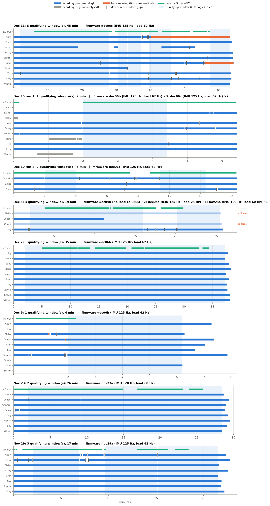

# Sled dog stride synchrony

Analysis code for *"Sprint sled dogs need not synchronize"* (Seleb, Bull,
Bhamla; manuscript in preparation). It takes per-dog IMU and tugline-force
loggers, plus a GPS logger, from field runs of 10-dog sprint teams.

**Manuscript (read-only, for contributors):**
<https://www.overleaf.com/read/dmmvmqmjxzfk#0405d0>. Please don't share the
link outside the project.

The manuscript's empirical results come from one 13-minute window of one
run (Dec 11, 2022). This repo reproduces that analysis exactly. It also
applies the same pipeline to every other usable recording from the season,
to test whether the results replicate. The toy pulling model (manuscript
Fig. 5) is not included here yet.

## Results

Full tables are in [docs/RESULTS.md](docs/RESULTS.md), generated by
`scripts/summarize.py`.

- **Data:** 8 runs, 30 dogs, 56 dog-runs, 154 min of qualifying multi-dog
  windows. Which recordings are used, and why, is in
  [docs/DATA_VETTING.md](docs/DATA_VETTING.md).
- **Phase locking stays rare.** 0.48% of 10,339 pairwise 60 s windows are
  significant, against 1.1% in the manuscript's primary window. Independent
  of the Dec 11 session it's 0.30%, and 0.20% once dogs flagged for
  segmentation review are set aside. The clean locking concentrates in two
  pairs: Healy–Sitka (Dec 11, 10 of 109 windows) and Arrow–Sassy (Nov 23,
  5 of 71).
- **The force–phase result replicates.** In all 41 unflagged fits, the
  autoregressive term dominates (β_ω −0.75 to −0.34, R² 0.22–0.51), and the
  phase terms stay weak. β_F is small and positive in all 47 fits. On the
  Dec 11 primary window (Table I): R² 0.24–0.43, β_ω −0.40 to −0.63.

| Run | Verified dogs | Pairs | PLV windows | Significant |
|---|---:|---:|---:|---:|
| Dec 11 (full session) | 10 | 223 | 4,065 | 0.76% |
| Dec 7 | 10 | 45 | 4,320 | 0.23% |
| Nov 23 | 7 | 42 | 1,491 | 0.54% |
| Nov 29 | 8 | 64 | 457 | 0.22% |
| Dec 10, run 1 | 2 | 1 | 6 | 0% |

## Limitations of the data

The loggers were still being developed during the season, so the recordings
are uneven ([details](docs/DATA_VETTING.md#limitations-of-the-recordings)):

- **Firmware changed from day to day.** Column layout, header length, and
  IMU and load-cell sample rates vary by run. Nov 23 was logged at ~120 Hz
  with jittered timing.
- **Clock sync wasn't reliable until Dec 11.** Before then, a logger could
  label its data with the wrong GPS second after a reboot, i.e. be off by
  a whole number of seconds. Every boot segment is therefore checked from
  the data ([docs/SYNC_CHECK.md](docs/SYNC_CHECK.md)), and only verified
  segments enter the pairwise analysis.
- **Recordings are fragmented.** Loggers reboot after communication or
  force-data errors, and load cells drop out. The pairwise analysis is
  restricted to windows where at least two dogs record at once:



## Layout

```
synchrony/            the pipeline (one shared module set; nothing is per-run)
  datasets.py         every run: tier, dogs, files, exclusions; Dec 11 primary-window constants
  config.py           data/result locations (environment variables, see below)
  io.py               raw CSV loading, corruption trimming
  formatting.py       Dec 11 primary-window data from the raw files
  gps.py              GPS run start, smoothed speed on the IMU axis, lag estimate
  phase.py            stride segmentation and phase reduction (Eq. 1)
  windows.py          qualifying multi-dog windows
  sync_check.py       per-boot-segment clock-sync verdicts
  gps_lag.py          GPS speed latency per run
  force.py            load-cell masking, force-phase Huber regression (Eq. 4)
  force_qa.py         load-cell QA table
  plv.py              pooled-surrogate windowed PLV (Eq. 3)
  analysis.py         both analyses over every qualifying window
scripts/              00_format_dec11 → 01_build_windows → 02_sync_check → 03_gps_lag
                      → 04_force_qa → 05_run_analysis → 06_table1; summarize
figures/              figure scripts → docs/figures/
tools/                hand-correction GUI + notebook for flagged dogs' segmentation
data/curated/         small hand-made inputs (committed): curated Dec 11 crossings, hand corrections
results/              every output CSV (committed)
docs/                 RESULTS.md, PIPELINE.md, DATA_VETTING.md, SYNC_CHECK.md, METHODS_NOTES.md
```

## Data

Only the raw logger CSVs are needed (≈ 3 GB; not in the repo). Point
`SLEDDOG_RAW` at the folder of per-day directories (`DEC_11_TEST/Tango_Device11.csv`,
`GPSLogger00.csv`, …), or symlink it to the default location:

```bash
ln -s "/path/to/Michigan_2022/Team Run Data" data/raw
```

File formats and the vetting of every folder are in
[docs/DATA_VETTING.md](docs/DATA_VETTING.md).

## Running

Python 3.12, with the pinned versions in `requirements.txt`.

```bash
pip install -r requirements.txt
scripts/run_all.sh                       # steps 00-06 (PLV in step 05 is the slow part)
python3 scripts/summarize.py             # docs/RESULTS.md
python3 figures/recording_timeline.py    # docs/figures/
python3 figures/pipeline_figures.py
python3 figures/sync_figures.py
python3 figures/phase_locking_figure.py  # default: Nov 23, focal dog Arrow
```

Run the steps in order: each one reads the previous one's output.
`05_run_analysis.py --force-only` skips PLV, and `--days=NOV_23_TEST,...`
reruns only those runs and splices them into the existing CSVs. How each
step works is in [docs/PIPELINE.md](docs/PIPELINE.md), and the reasoning
behind method choices is in [docs/METHODS_NOTES.md](docs/METHODS_NOTES.md).

### Hand-correcting segmentation

Six dog-runs are flagged (`hand_check` in
`results/analysis/force_phase_regression.csv`): Shifter (Dec 11, Dec 10
run 1), Aly and Stevie (Dec 7), Chips (Dec 10 run 2), Blaise (Nov 29).
`tools/hand_correct_segmentation.ipynb` walks through them in a local
Jupyter session (needs `%matplotlib qt`). Saved corrections are picked up by
`05_run_analysis.py` automatically.

## To do

- Hand-correct the flagged dogs (Shifter, Dec 11 first: 19 of the 50
  significant PLV windows involve him), then rerun step 5.
- Add Nov 18: one 46-min window with 3 dogs (Captain, Mikey, Mirage), missed
  earlier because of a header-parsing bug. It needs the sync check, and its
  GPS speed spline blows up at one edge.
- Quantify the effect of the ~120 Hz jittered sampling on Nov 23 (resample to
  a uniform grid before filtering and compare).
- Nov 23 and Nov 29 field notes and team positions.
- Whether β_F > 0 survives adding GPS team acceleration as a covariate.
- Dec 6, run 1: about an hour with three verified dogs, but no usable GPS.
- Toy pulling model code (on another machine; here or in a separate repo).
