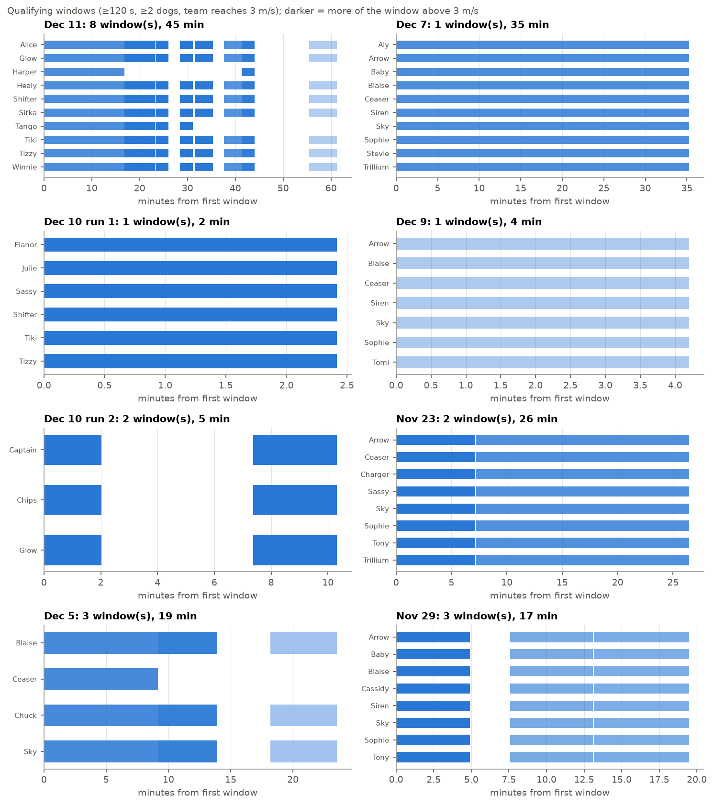
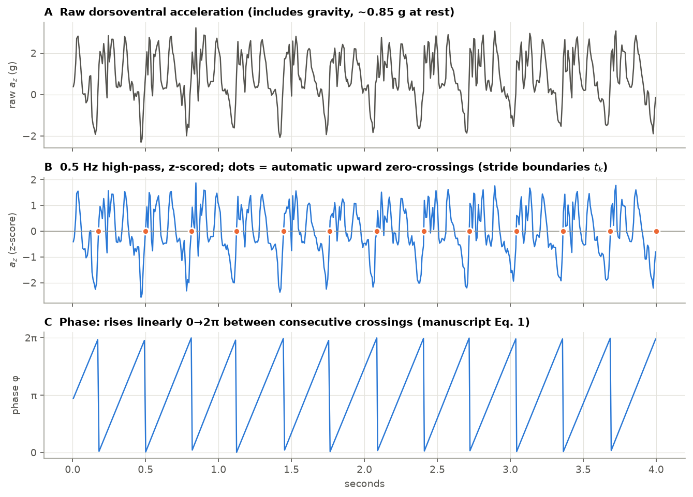
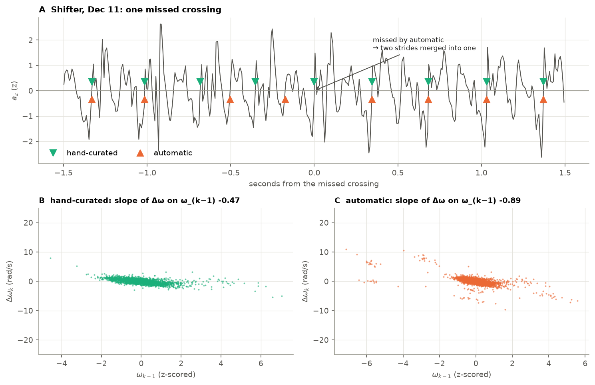
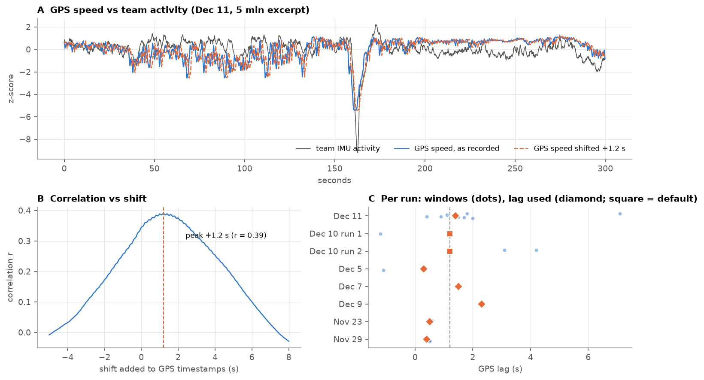
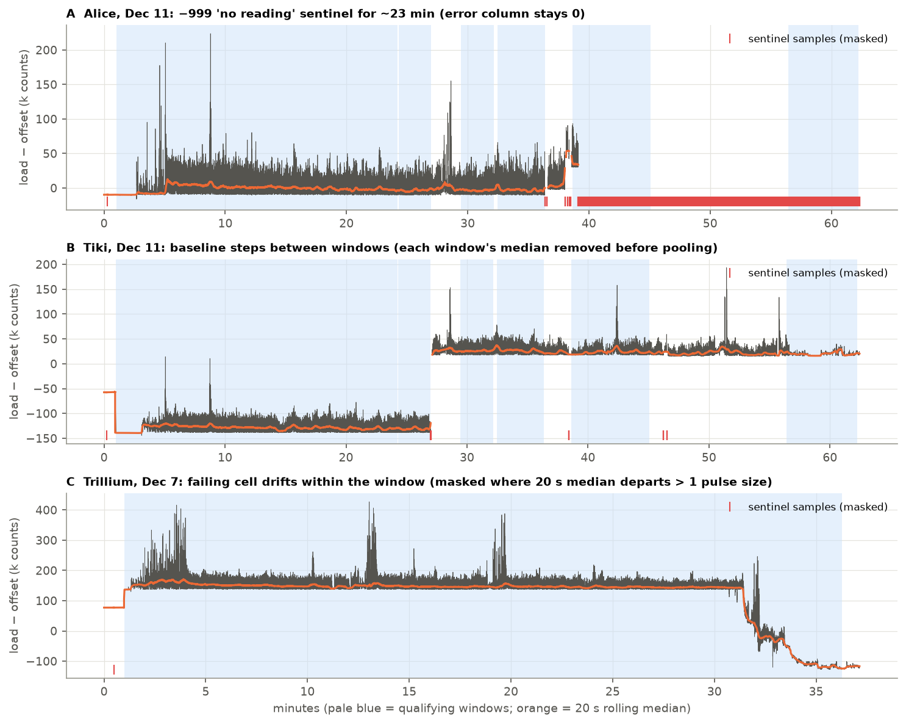
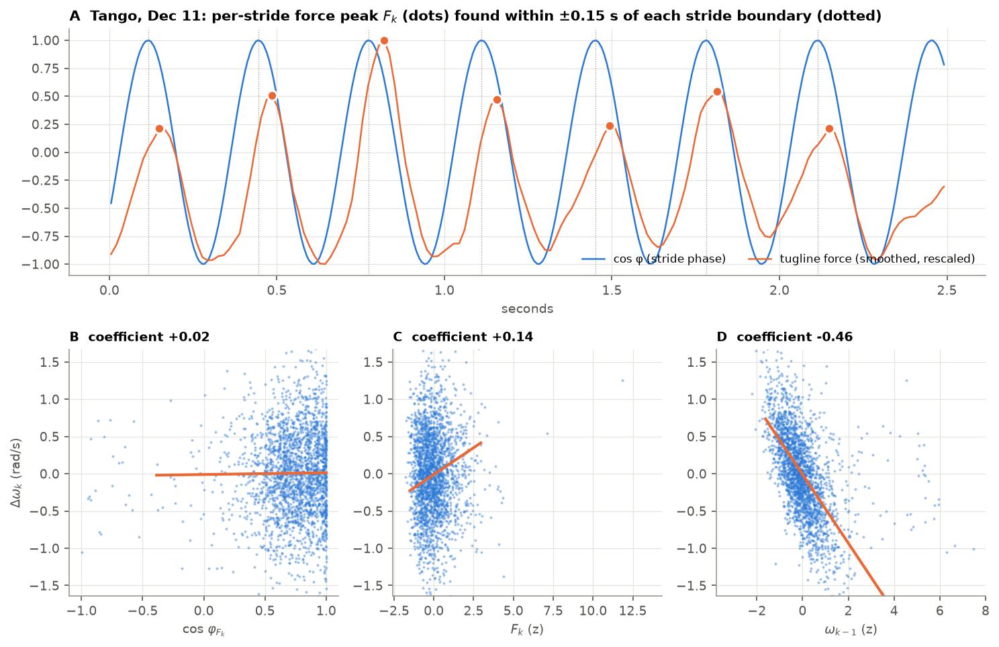
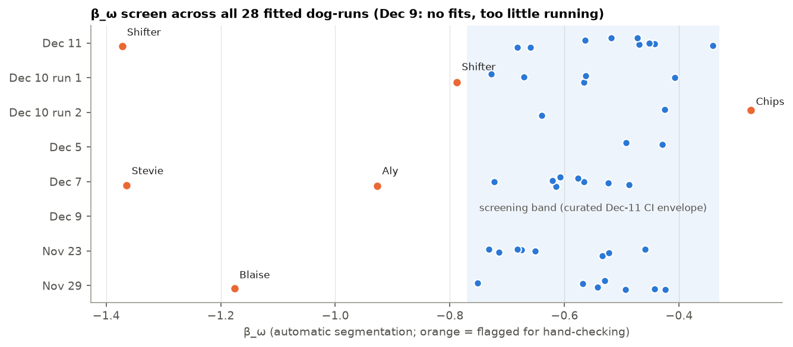
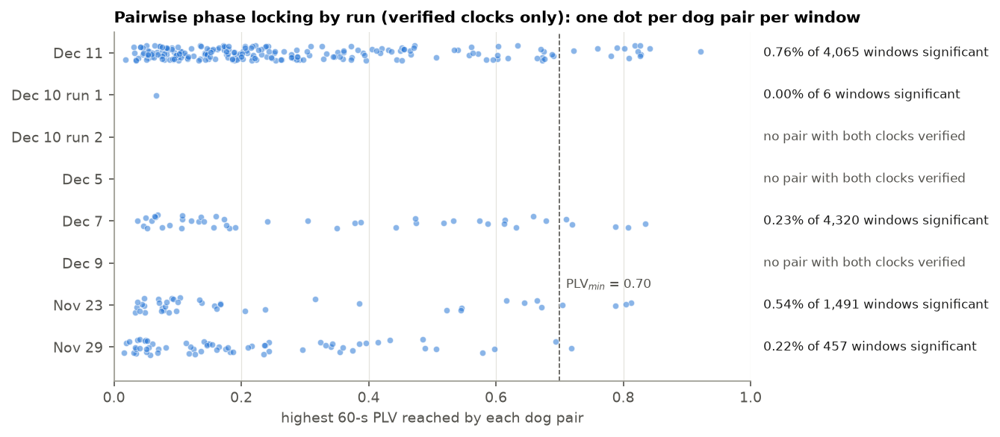
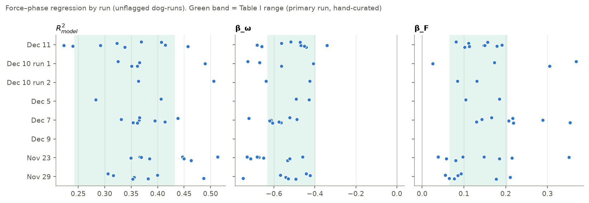
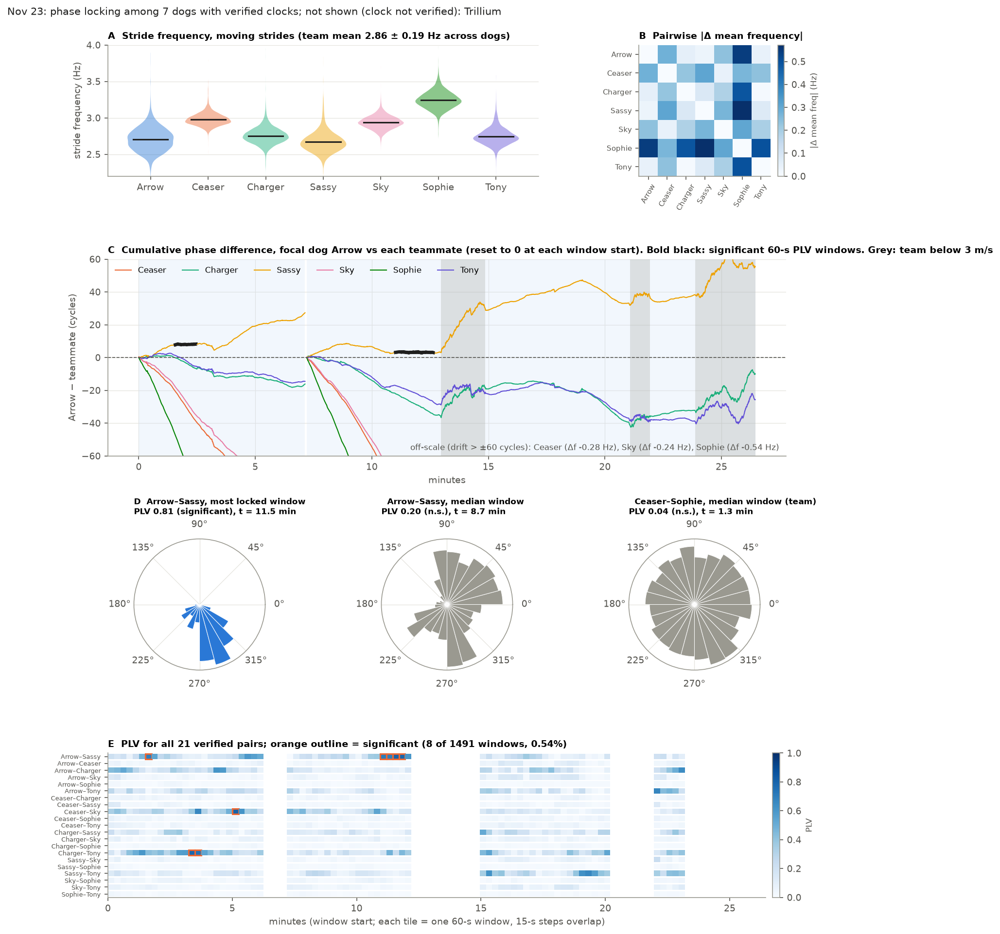

# Pipeline, step by step

How raw logger files become the two analyses in *"Sprint sled dogs need not
synchronize"*:

- pairwise phase locking (manuscript Eq. 3)
- the force–phase regression (Eq. 4, Table I)

Run them on every usable 2022 recording. Figures are produced by
`figures/pipeline_figures.py` from the real data and the result CSVs.
Decisions and their evidence are in [METHODS_NOTES.md](METHODS_NOTES.md).

| Step | Script | Module | Output |
|---|---|---|---|
| 0 Dec 11 primary-window data | `scripts/00_format_dec11.py` | `formatting.py` | `data/dec11_formatted/` |
| 1 Qualifying windows | `scripts/01_build_windows.py` | `windows.py`, `io.py` | `results/windows/` |
| 2 Clock sync | `scripts/02_sync_check.py` | `sync_check.py` | `results/sync_check/` |
| 3 GPS lag per run | `scripts/03_gps_lag.py` | `gps_lag.py`, `gps.py` | `results/gps_lags.csv` |
| 4 Load-cell QA | `scripts/04_force_qa.py` | `force_qa.py`, `force.py` | `results/force_scan.csv` |
| 5 Both analyses | `scripts/05_run_analysis.py` | `analysis.py`, `phase.py`, `force.py`, `plv.py` | `results/analysis/` |
| 6 Table I | `scripts/06_table1.py` | `force.py` | `results/tables/table1.csv` |
| Tables | `scripts/summarize.py` | | [RESULTS.md](RESULTS.md) |

Every run goes through the same code. The only per-run inputs are the
entries in `synchrony/datasets.py`.

---

## 1. Load, trim, find windows

Each dog's file is cut at its first sign of corruption (`io.trim_corruption`;
criteria in [DATA_VETTING.md](DATA_VETTING.md#corruption-trimming)). Its
contiguous stretches are then found. A gap > 1 s is a device reboot.
Sweeping across dogs gives every interval with ≥ 2 dogs recording. An
interval is kept whole if the team reaches 3 m/s anywhere in it. Slow strides
are removed later, stride by stride. **Qualifying windows** are those ≥ 120 s.

*Why the data are choppy. Each dog's logger reboots after a comm or
force-data error, leaving a gap (tick), and its load cell can drop out
(orange) or be absent (pale). Pairwise analysis needs two dogs recording at
once, so it is restricted to the shaded windows. See
[DATA_VETTING.md](DATA_VETTING.md#limitations-of-the-recordings).*

*Each bar is a dog's participation in a qualifying window. Darker means more
of the window is above 3 m/s.*

## 2. Stride segmentation and phase (Eq. 1)

`phase.segment_and_phase`:

1. High-pass `az` at 0.5 Hz to remove gravity. Raw `az` sits near 0.85 g at
   rest, and the dog's orientation drifts through a run.
2. z-score.
3. `marker_event`: low-pass the jerk at 8 Hz, find its peaks ≥ 0.25 s apart,
   and take the upward zero crossing of `az` within ±5 samples of each peak.
   These crossings are the stride boundaries t_k.
4. Phase rises linearly from 0 to 2π between consecutive crossings
   (`time_interpolated_phase`).

Segmentation is automatic everywhere. A hand-corrected file in
`data/curated/hand_corrected/` replaces it for that dog-run when present.
Dogs whose automatic segmentation is suspect are found by the β_ω screen
(step 5).

*A missed crossing merges two strides (A). The merged stride has a very low ω,
and the next stride a large positive Δω (B, C). These outlier pairs pull the
β_ω slope steeper, which is why β_ω flags segmentation errors.*

## 3. Speed gate and GPS lag

Only strides with GPS speed ≥ 3 m/s at both boundaries are used, and force
peaks below 3 m/s are never picked. GPS speed lags the IMUs, so each run gets
its own lag. It is estimated by correlating high-passed GPS speed with the
team's median activity envelope (`gps_lag.py`), and falls back to 1.2 s
without a clear peak. GPS speed is spline-smoothed (`s = 900`) after dropping
> 10 m/s artifacts, as in the manuscript.

## 4. Clock sync

Covered in its own document: [SYNC_CHECK.md](SYNC_CHECK.md). In short, every
device reboot can mislabel the second, so each boot segment is checked with
a whole-second force cross-correlation against the team, and **only verified
segments enter PLV**.

## 5a. Load-cell QA and the force–phase regression (Eq. 4)

`force.force_valid_mask` masks:

- firmware sentinels (`−999`, `404`)
- cells with no reading at all
- in-window baseline drift

Each window's median force is removed before pooling, so a baseline step
between windows can't masquerade as pull strength.

For each stride k, the force peak within ±0.15 s of the boundary gives its
magnitude F_k and its phase φ_Fk. The robust (Huber) fit is

Δω_k = β₀ + β_cos cos φ_Fk + β_sin sin φ_Fk + β_F F_k + β_ω ω_{k−1}

with F_k and ω_{k−1} z-scored per dog, A_φ = √(β_cos² + β_sin²), and
θ₀ = atan2(β_sin, β_cos).

**β_ω screen.** A dog-run with β_ω outside [−0.77, −0.33] (the curated Dec 11
CI envelope) is flagged `hand_check` for manual segmentation, and kept out
of the reported ranges until corrected.

## 5b. Pairwise phase locking (Eq. 3)

For each pair of verified dogs in a window, phases go on a shared 125 Hz grid
and are NaN below 3 m/s. PLV = |⟨e^{iΔφ}⟩| is computed in 60 s windows with
a 15 s step; windows < 90% valid aren't tested. Significance comes from a
pooled null of 800 circular time shifts per pair: PLV > τ95 and PLV > 0.70
(`plv.windowed_plv_pooled`, an exact port of the manuscript's code).

*Unflagged dog-runs. The green band is the Table I range (Dec 11 primary window).*

*Fig. 4-style view of Nov 23 (focal dog Arrow, 7 verified dogs). Bold black
marks significant windows. Arrow–Sassy's two plateaus are the only sustained
locking on that run.*
