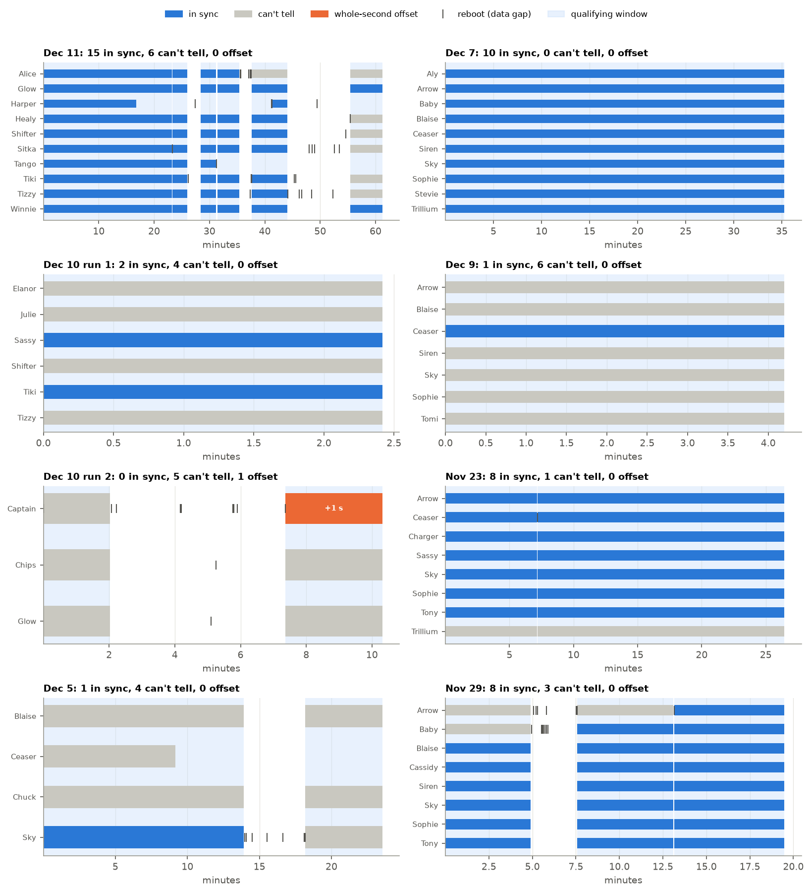
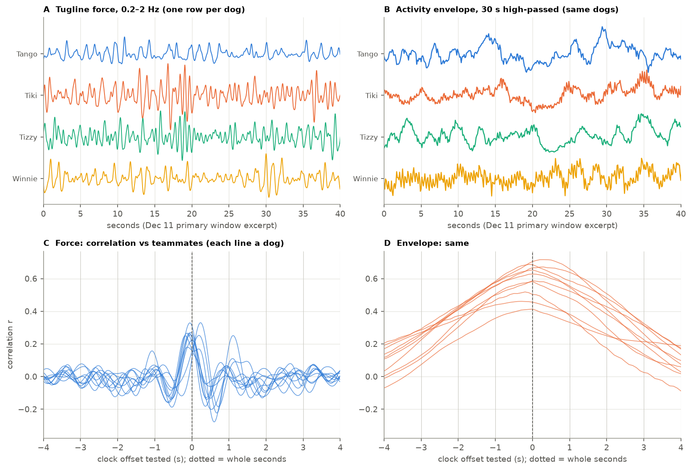
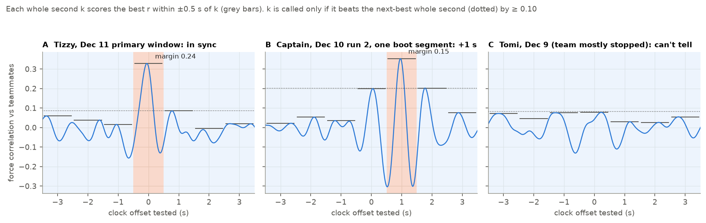
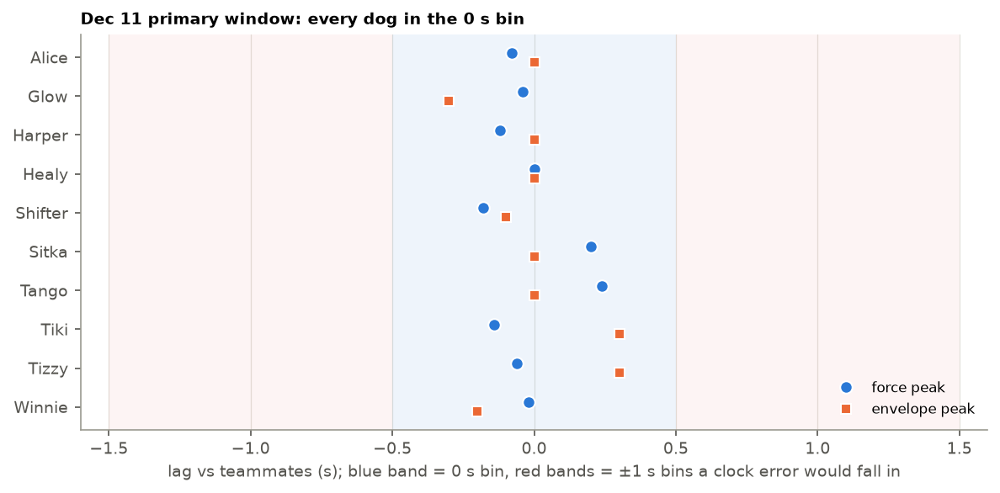
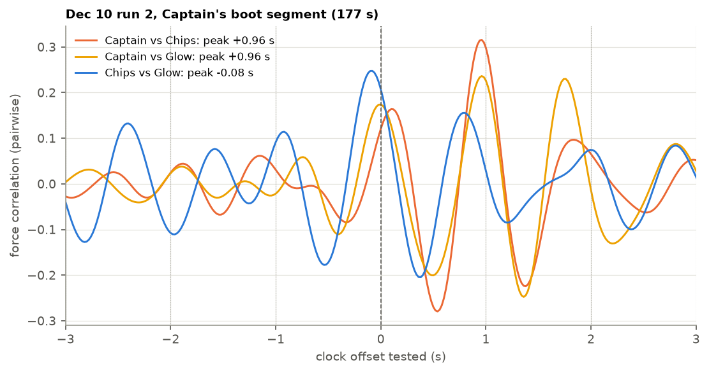

# Clock-sync check

Pairwise PLV compares two dogs' phases at the same instant, so their clocks
have to agree. Field confirmation (an LED blink check) exists only for Dec 10
and Dec 11. Everything else is verified from the data, in
`synchrony/sync_check.py` (`scripts/02_sync_check.py`). Figures are in
`docs/figures/sync/`, produced by `figures/sync_figures.py`.

## What can go wrong

These follow from the logger firmware:

- **Every gap in a dog's data is a reboot.** The firmware forces a reset
  after an error, usually corrupted force data. Every analysed gap is a
  whole number of seconds plus one sample (1.007, 3.007 s, …).
- **After a reboot, logging restarts on a GPS pulse (PPS),** and the loop
  stays locked to the top of each GPS second. So devices sample in step to
  within a sample.
- **The weak point is the time label.** The first GPS message after startup
  sometimes carries a time that doesn't match the latest pulse. The whole
  boot segment is then stamped off by an integer number of seconds. This
  varies reset to reset, so every boot segment has to be checked on its own.

Consequences: offsets are whole seconds; an offset is constant within a boot
segment; and sub-second lags between dogs (±0.3 s on Dec 11) are reaction
time or position, not clock error. The question per boot segment is "0, or
±k s?".

*Every analysed piece of every dog, by run. Pale blue: qualifying windows.
Ticks: reboots. Bars are coloured by the boot segment's verdict.*

## Method

The unit is each dog's boot segment, intersected with the qualifying windows
it belongs to. All data come from inside validated windows.

1. **Signal: tugline force, band-passed to 0.2–2 Hz.** When the rig jolts,
   brakes or surges, every tugline feels it at almost the same instant.
   The band sits below the ~3 Hz stride, so the dogs' own (unshared) stride
   pulses drop out. Each teammate is filtered within its own boot segments,
   so its reboots can't create fake edges.
2. **Reference: the median of the teammates' force.** The median keeps one
   bad teammate from dragging the reference.
3. **Whole-second call.** Correlate over shifts of −8 to +8 s, and score each
   whole second k ∈ −7..7 as the best r within ±0.5 s of k. Call k only if it
   beats the runner-up by ≥ 0.10 (`FORCE_MARGIN_MIN`). If the peak sits at
   the search edge, no call is made.
4. **Long spans (≥ 10 min)** also get calls on equal ~300 s pieces, pooled
   with the whole-span call. A boot segment is *in sync* only if every
   confident call says 0 s, and *CONFLICT* if calls disagree (none do).
5. **Fallback** for spans ≥ 10 min with no usable force: the activity
   envelope (1 s RMS of high-passed |a|, 30 s high-passed), whose ~3 s wide
   peak resolves whole seconds only over long spans.

*Why force: its correlation peak is ~0.35 s wide (C), while the envelope's
is ~3 s wide and barely drops at ±1 s (D).*

## Calibration

The Dec 11 primary window has field-confirmed sync, so every dog's true
offset is 0 s. It was cut into 60–600 s
pieces (every 30 s) and puts each through the same call.

| Piece length | Force: pieces called | Force: wrong calls |
|---|---|---|
| 60 s | 38% | 4% |
| 120 s | 47% | 1.0% |
| 180 s | 50% | 0% |
| 300 s | 61% | 0% |
| 600 s | 72% | 0% |

When force makes a call it is almost always right, and about half of the
short pieces get no call. The envelope's ~3 s wide peak can't separate whole
seconds over short spans, so it is only a fallback for spans ≥ 10 min. Its
lag precision by length is in `window_length_calibration.csv`: 99% of
in-sync lags fall within ~2 s at 120–180 s and 0.3 s over the full 766 s.
Offsets of 0.3–20 s injected into one dog are recovered against the team
within 0.3 s (`injection_test.csv`). Caveat: this all rests on one run, and
overlapping pieces of one 13-minute window aren't independent.

*Dec 11 primary window: all 10 dogs land in the 0 s bin. Residuals are
−0.18 to +0.24 s.*

## Positive control

The Dec 10 field notes name two dogs whose LEDs blinked out of step: Julie
(run 1, "early on") and Captain (run 2, "about 1/3 of the way through").
Checking every ≥ 120 s boot
segment across both full runs:

- Julie: force peak at +1.0 s in all 5 segments, 3 confident +1 s calls.
- Captain: +1.0 s in all 4 segments from 11 min on, 2 confident +1 s calls.
- No segment of a known-bad dog is ever called in sync.

It also caught one error nobody noted: Healy (Dec 10 run 1) at −5 s. He is
in no analysed window.

*Captain's offset segment closes the triangle: he lines up with Chips and
with Glow at +0.96 s, while Chips and Glow agree at −0.08 s.*

## Results

| | Boot segments | In sync | Can't tell | Offset |
|---|---:|---:|---:|---:|
| Analysed runs | 75 | 45 | 29 | 1 (Captain, Dec 10 run 2: +1 s) |

"Can't tell" mostly means a short piece between reboots, a stopped team
(Dec 9), or no load reading (Dec 5).

## Rule used by the analysis

**Verified segments only (Ben, 2026-10-10).** A dog enters a PLV window only
if its covering boot segment is *in sync*. Undecidable segments are excluded
as well as offset ones. Sync is relational, so every pair is two verified
dogs. This drops Dec 5, Dec 9 and Dec 10 run 2 from PLV. Each drop is logged
to `results/analysis/sync_trimmed.csv`. The force regression is per dog and
unaffected.

An undetected 1 s error would lower PLV, i.e. bias toward "no synchrony". So
excluding undecidable segments is the conservative choice for this paper's
claim.

## Limits

- Calibrated on one run.
- Needs working load cells and shared jolts. A stopped team gives nothing to
  align on.
- Three-dog runs are fragile, since the median of two teammates is just
  their average.
- About half of boot segments are undecidable, so the rule costs data.
